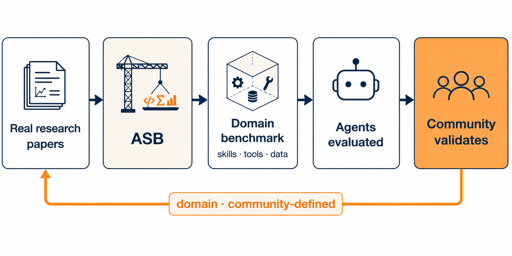
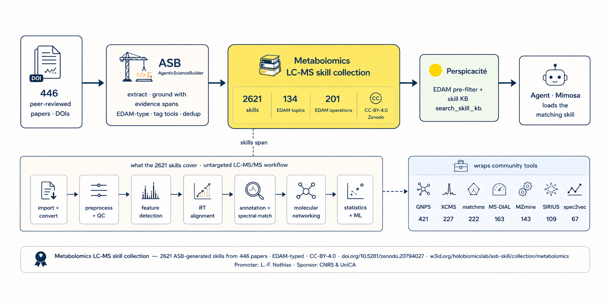

<p align="center">
  <picture>
    <source media="(prefers-color-scheme: dark)" srcset="assets/brand/asb-logo-dark.svg">
    <source media="(prefers-color-scheme: light)" srcset="assets/brand/asb-logo.svg">
    
  </picture>
</p>

<h1 align="center">ASB Skill Collections</h1>

<p align="center">Evidence-grounded skills and software-tool records for scientific AI agents,<br>distilled from published method papers and their code by the AgenticScienceBuilder pipeline.</p>

<p align="center">
  <a href="collections/metabolomics/v2"></a> <a href="collections/metabolomics/v2/skills_index.json"></a>
  <a href="collections/metabolomics/v2/tools_index.json"></a> <a href="collections/metabolomics/v2/corpus.yaml"></a>
  <a href="collections/metabolomics/v2/workflows"></a> <a href="LICENSE"></a>
  <a href="LICENSING.md"></a> <a href="https://doi.org/10.5281/zenodo.20794026"></a>
</p>

A skill is a short procedure that an AI agent can read and follow. The
AgenticScienceBuilder (ASB) pipeline writes each one from a method paper (54 of the
566 are preprints) and, where one exists, its public code repository, anchors it to
verbatim evidence from those sources (for `repo-oa` papers, the repository's own
documentation; [CONTENT_POLICY.md](governance/CONTENT_POLICY.md)), annotates it with
EDAM terms, and passes it through a licence and PII gate before release. This
repository is the public registry of those collections: the released metabolomics
collection, its per-technique packs, the install and search tooling, and the
governance of the community that curates them. The project started at the
Dagstuhl Seminar **Computational Metabolomics**
([26181](https://www.dagstuhl.de/en/seminars/seminar-calendar/seminar-details/26181),
26 to 30 April 2026).

## This release

[`collections/metabolomics/v2`](collections/metabolomics/v2), release
`metabolomics-v0.2.0` (preliminary): **5,859 skills** across **909 tools**,
distilled from **566 papers**, plus **21 composite workflow super-skills** that
chain the atomic skills into end-to-end pipelines
([`workflows/`](collections/metabolomics/v2/workflows)). Coverage is mostly
LC-MS/MS, with LC-MS, GC-MS, mass-spectrometry imaging, ion mobility and
lipidomics, some NMR, and multi-omics, statistics and pathway tools.

| Layer | Contents | State |
|---|---|---|
| ASB-Skills | evidence-grounded procedural skills | released |
| ASB-Workflows | composite end-to-end pipeline super-skills | released |
| ASB-Tools | deduplicated software-tool records with EDAM terms and DOIs | released |
| ASB-Benchmark | per-paper tasks and claim-retrieval test sets | later |
| ASB-Capsules | raw per-paper pipeline outputs, for full traceability | later |

<p align="center">
  
</p>

## Install

**Claude Code** (plugin marketplace, public GitHub route):

```bash
/plugin marketplace add HolobiomicsLab/asb-skill-collections
/plugin install metabolomics@asb-skill-collections
```

This route was verified at CLI level on 2026-10-30 with Claude Code 2.1.304:
`claude plugin marketplace add HolobiomicsLab/asb-skill-collections` and
`claude plugin install metabolomics@asb-skill-collections` both exited 0. Loading
the skills in a live session was not exercised. The marketplace keeps a clone of
this repository (286 MB) beside the plugin cache (72 MB), about 358 MB on disk.
From a local checkout, `claude plugin marketplace add "$PWD"` then
`claude plugin install metabolomics@asb-skill-collections` installs the same
plugin without that clone
([USAGE §1](collections/metabolomics/v2/USAGE.md#claude-code-verified-local-marketplace-route)).
Per-technique packs such as `metabolomics-lc-ms` are lighter subsets
([packs/metabolomics](packs/metabolomics/README.md)): `metabolomics-lc-ms` was
installed the same way at CLI level (29 MB plugin cache), and the other seven
packs were built but not installed.

**Other agent runtimes** (`asbb` CLI from a checkout; Python 3.12 or later and PyYAML,
in a virtual environment):

```bash
git clone https://github.com/HolobiomicsLab/asb-skill-collections
cd asb-skill-collections
uv venv -p 3.12 --allow-existing && source .venv/bin/activate && uv pip install pyyaml
python3 -m asb_skill_collections.asbb_cli install metabolomics --runtime agents   # ~/.agents/skills (Codex, Copilot CLI, Gemini CLI)
python3 -m asb_skill_collections.asbb_cli install --list-runtimes                 # agents (verified), codex, copilot, gemini, claude, cursor, cline, vscode-copilot, --dest DIR (experimental)
```

Without uv, `python3.12 -m venv .venv && . .venv/bin/activate && python -m pip install pyyaml`
prepares the same environment. On macOS the environment is needed: Homebrew's Python
refuses a system-wide `pip install`, and Apple's `/usr/bin/python3` is older than 3.12.
Each install copies the unit into a content-addressed snapshot that survives a moved
checkout; rerun `install` to refresh ([usage guide](collections/metabolomics/v2/USAGE.md#1-install-one-domain-collection):
commands, outputs, `uninstall`). Any other agent can read the Markdown and JSON under
`collections/metabolomics/v2/` directly ([AGENTS.md](AGENTS.md)). Not on PyPI in v0: an index
install would fetch the CLI without the corpus it reads. Verified routes and dates: [docs/STATUS.md](docs/STATUS.md).

### Choose what to install

Install the whole collection, a technique pack, a selection of skills
(`asbb install --skills`, `--skills-file` or `--query`), or fetch chosen skills
without a checkout (`asbb fetch`). Commands, outputs and refusals:
[docs/partial-install.md](docs/partial-install.md).

| Install | Technique tag | Leaves | On disk (`du`) |
|---|---|---:|---:|
| `metabolomics`, the full collection | all | 5,859 | 72 MiB |
| `metabolomics-lc-ms` | `LC-MS` | 2,617 | 29 MiB |
| `metabolomics-ms-generic` | `mass-spectrometry` | 804 | 8.5 MiB |
| `metabolomics-ion-mobility` | `ion-mobility-MS` | 385 | 4.3 MiB |
| `metabolomics-gc-ms` | `GC-MS` | 367 | 4.0 MiB |
| `metabolomics-ms-imaging` | `MS-imaging` | 291 | 3.2 MiB |
| `metabolomics-nmr` | `NMR` | 276 | 2.9 MiB |
| `metabolomics-ce-ms` | `CE-MS` | 113 | 1.4 MiB |
| `metabolomics-direct-infusion` | `direct-infusion-MS` | 97 | 1.1 MiB |
| a selection, `asbb install --skills a,b,c --collection metabolomics/v2 --runtime agents` | chosen slugs | 10 in the example | 188 KiB |
| a fetch, `asbb fetch a,b --collection metabolomics/v2 --dest DIR` | chosen slugs | 10 in the example | 112 KiB |

The first nine rows install by name: `/plugin install <name>@asb-skill-collections`
in Claude Code, where the public marketplace also keeps its 286 MB clone of this
repository, or `python3 -m asb_skill_collections.asbb_cli install <name> --runtime agents`.
Their sizes are `du -sk` of the built unit in this repository on 2026-10-31; the
selection and fetch rows are the 10-skill example of
[docs/partial-install.md](docs/partial-install.md#sizes), and a fetch also
downloads the 5.2 MiB (5,430,046 bytes) `skills_index.json`. `du` counts allocated
blocks, so the full collection that takes 72 MiB here is the 61 MB of file content
that docs/partial-install.md reports.

Packs overlap: a skill tagged with several techniques is in several packs, so
install the full collection or a few packs, not both. The 1,520 technique-agnostic
skills (statistics, pathway and generic data-handling procedures) carry no
technique tag and are in no pack; they come with the full collection, a selection
or a fetch.

## Use: search, apply, ground

**Search** a checkout offline, with no API key:

```bash
uv venv -p 3.12 --allow-existing && source .venv/bin/activate
uv pip install -e .            # in a python3.12 -m venv environment: python -m pip install -e .
asbb search "untargeted LC-MS/MS annotation" --collection metabolomics --target workflows
asbb get untargeted-lcmsms-annotation --collection metabolomics/v2 --target workflows
asbb search --list-collections
```

Without installing, `python3 -m asb_skill_collections.asbb_cli` runs the same
commands. The CLI, the router, the MCP server and the collection-level search
scripts share one versioned selector; each hit reports its score, matched fields
and qualified slug. [How offline skill selection works](docs/selection.md)
documents the rule, its tie handling and its 22-query measurement.

**Apply.** Read the skill's `SKILL.md` and follow the procedure. Tool
requirements are in its frontmatter and in [USAGE §0](collections/metabolomics/v2/USAGE.md#0-requirements).

**Ground.** To check an exact parameter, threshold or claim (the difference
between "the skill says about 5 ppm" and "the paper specifies 5 ppm"), ground the
skill against its source paper. Grounding is optional, ships inside every plugin
and pack, and uses [Perspicacité](https://github.com/HolobiomicsLab/Perspicacite-AI),
Holobiomics Lab's local-first literature RAG engine, with two backends:

- **`kb`**: RAG over the paper's full text and supplementary information. The
  per-paper KB (`asb-paper-<doi>`) is created on first use through the Perspicacité
  HTTP API; no MCP server is required. Needs Perspicacité at `PERSPICACITE_BASE`
  (default `http://127.0.0.1:8000`).
- **`local`**: no server. Clones the skill's source repository and fetches the
  open-access paper where possible. Needs `git` and network.

In Claude Code, run `/ground` on the skill in play; elsewhere, call the bundled
`bin/perspicacite_kb_bind.py` (`prepare`, `query`, `local`). Full guide:
[USAGE §4](collections/metabolomics/v2/USAGE.md#4-ground-recommended--verify-against-the-source-kb-or-serverless).

## What is in the collection

<p align="center">
  
  <br><sub>The LC-MS view of the collection (the <code>metabolomics-lc-ms</code> pack). The full release covers all techniques.</sub>
</p>

| File | Contents |
|---|---|
| `leaves/<slug>/SKILL.md` | one evidence-grounded skill each (frontmatter: EDAM IRIs, `derived_from` DOIs, `tools`, `attribution`; verbatim evidence lines in the body). Shipped as data and read on demand, so installing does not load the corpus into the session's context. |
| `skills/*/SKILL.md` | three advertised entries: the router, the collection and licence policy, the contribution channel |
| `workflows/<slug>/SKILL.md` | composite workflows and their router, `workflows/_workflow_router/SKILL.md` |
| `tools/<slug>.yaml` | deduplicated software-tool records with EDAM terms and source DOIs |
| `skills_index.json`, `tools_index.json` | machine search indexes (EDAM IRI, tool name, keyword) |
| `kb_bundle.json` | skill to source-paper KB slugs and `repo_urls` (the grounding map) |
| `bin/perspicacite_kb_bind.py`, `commands/ground.md`, `GROUNDING.md` | packaged grounding: the binder, the `/ground` command and a how-to |
| `commands/*.md` | the four plugin commands: `/ground`; `/propose-skill`, which stages a community skill proposal; `/synthesize-meta-skill`, which stages a workflow super-skill proposal; `/claim-skill`, run by a maintainer to turn a tool author's claim into a proposal that credits the author |
| `collection.yaml`, `corpus.yaml` | collection record; per-paper access basis (`repo-oa`) |
| `CITATION.cff`, `PROVENANCE.md`, `gate_report.json` | citation, how it was generated, release-gate verdict |

The default entry point is `skills/_router/SKILL.md`. Technique and EDAM-topic
breakdowns and the selection criteria are in [ABOUT.md](collections/metabolomics/v2/ABOUT.md).

## How it was generated

Skills come from method papers anchored to the computational metabolomics review
series ([SOURCES.md](governance/SOURCES.md): sources and inclusion criteria;
[CONTENT_POLICY.md](governance/CONTENT_POLICY.md): legal and open-access policy).
[PROVENANCE.md](collections/metabolomics/v2/PROVENANCE.md) records the exact build
command and model routing: Claude Opus 4.8 for outline and card revision, Claude
Haiku 4.5 for the other stages, OpenAI `text-embedding-3-large` and `-small` for
embeddings, each build recorded in `build_manifest.json`.

## Repository family

| Repository | Role | Access |
|---|---|---|
| asb-skill-collections (this one) | registry, release tooling, governance, released metabolomics collection | public |
| AgenticScienceBuilder | the pipeline and schema that generate the collections | private, to follow |
| asb-skills-&lt;domain&gt; | one repository per domain, same `collections/<domain>/<version>/` and `packs/<domain>/<technique>/` layout | private, to follow |
| indicium | standard for a typed scientific claim bound to the evidence that grounds it | private, to follow |
| indicium-adapters, indicium-adapters-&lt;domain&gt; | per-domain adapters that enrich indicium claims with ontology terms | private, to follow |
| [Perspicacite-AI](https://github.com/HolobiomicsLab/Perspicacite-AI) | literature RAG engine used for grounding | public |
| [Mimosa-AI](https://github.com/HolobiomicsLab/Mimosa-AI) | multi-agent framework for autonomous scientific research | public |

Domain and adapter repositories exist for metabolomics and nine further domains
(agentic AI, astronomy, epigenomics, genomics, metabarcoding, metagenomics, multi-omics,
proteomics, transcriptomics) and will be published with their releases. Until then the
metabolomics collection is served from here; `collections/` also holds staged
`epigenomics/v1`, `transcriptomics/v1` and `metabolomics/v1`, not part of this release.

## Attribution and citation

Cite the collection and the original paper behind each skill you use
(`attribution.original_doi` in its `SKILL.md`).

- **Concept DOI**, for all versions: [10.5281/zenodo.20794026](https://doi.org/10.5281/zenodo.20794026).
- **Version DOI** of the deposited version, `metabolomics-v0.1.0` (22 June 2026):
  [10.5281/zenodo.20794027](https://doi.org/10.5281/zenodo.20794027). The
  `metabolomics-v0.2.0` content of this repository is not yet deposited.
- **Authors.** The v2 deposit ([CITATION.cff](collections/metabolomics/v2/CITATION.cff)):
  AgenticScienceBuilder Community, Louis-Félix Nothias, HolobiomicsLab.cnrs.fr, MetaboLinkAI.net.
  From the next versioned release on ([root CITATION.cff](CITATION.cff)): Louis-Félix Nothias and
  the AgenticScienceBuilder AI framework, joined by curators ([call for curators](docs/CURATION_CALL.md)).
- **Per-skill roles** (`attribution:` in each `SKILL.md`): `generator` (the ASB
  pipeline), `curators` (none yet), `promoter` (Louis-Félix Nothias), `sponsor`
  (CNRS and Université Côte d'Azur, who paid the API cost), `original_doi`.

## Governance and licensing

Every skill carries a `license_tier` (in `skills_index.json` and in its `SKILL.md`
frontmatter) that answers *what may I do with the underlying tool?*

| Tier | Meaning |
|---|---|
| `open` | commercial use allowed (MIT, Apache-2.0, GPL, CC-BY, ...) |
| `noncommercial` | academic or noncommercial use only; **confirm permitted use before applying** the skill |
| `restricted` | licence established and it constrains reuse; **check it before commercial use or redistribution** |
| `unknown` | no tool-level licence evidence; describing and using are unaffected; **never redistribute** the tool's code |

The search tools do not filter by tier. The router tells the agent to prefer `open`
skills when no tier is requested, and to get confirmation of a permitted (academic or
noncommercial) use before applying a `noncommercial` one; the `asb-metabolomics`
meta-skill carries the same acknowledgement step. A technique pack's router carries the
`noncommercial` confirmation inline but no `open`-first default
([LICENSE_TIERS.md](governance/LICENSE_TIERS.md)). Code is
under [Apache-2.0](LICENSE), collection content under CC-BY-4.0; verbatim quotations
(`evidence_spans`) are minimal and attributed, and a rights holder may request removal
([LICENSING.md](LICENSING.md)). Other policies are in [governance/](governance), starting
with [MAINTAINERS.md](governance/MAINTAINERS.md) and [COI_POLICY.md](governance/COI_POLICY.md).

## Contributing

- **A skill was wrong, stale or missing.** The `asb-contribute` skill, shipped with
  the plugin, turns it into a redacted report you approve before anything is filed;
  from a checkout, `scripts/make_improvement_report.py` prints an anonymised issue body,
  and with `--print-url` a pre-filled issue URL.
- **Propose or annotate a paper, a collection or a workflow:**
  [CONTRIBUTING.md](.github/CONTRIBUTING.md#propose-or-annotate-a-paper).
- **Credit.** Merged contributions count on the contributor leaderboard and can lead
  to co-authorship of the next release DOI ([CONTRIBUTION_LOOP.md](governance/CONTRIBUTION_LOOP.md)).
- **Before packaging,** run `python -m scripts.unit_closure` from the repository root:
  it compares each shipped unit's indexes with its leaves and checks declared
  `metadata.helper` files.

## Status

- Verified for this release: the full `metabolomics` collection as a managed install, Claude Code from a local-checkout marketplace, and the checkout CLI.
- Verified at CLI level on 2026-10-30 (Claude Code 2.1.304), in-session load not exercised: Claude Code from the public GitHub marketplace (about 358 MB on disk) and the `metabolomics-lc-ms` pack.
- Pending or experimental: the other seven packs, the web UI, runtime adapters other than `agents`, the MCP server. Not yet published: PyPI, the documentation site, the HuggingFace mirror, the benchmark and the capsules.
- The `w3id.org/holobiomicslab/` and `w3id.org/asb` identifiers resolve. Dates, measurements and detail per surface: [docs/STATUS.md](docs/STATUS.md).

## Acknowledgements

We thank the participants and organisers of Dagstuhl Seminar 26181, Computational
Metabolomics, where this collaboration began. API generation costs for this
collection were sponsored by CNRS and Université Côte d'Azur. Maintained by
[Holobiomics Lab](https://github.com/HolobiomicsLab) (CNRS, Université Côte d'Azur).
