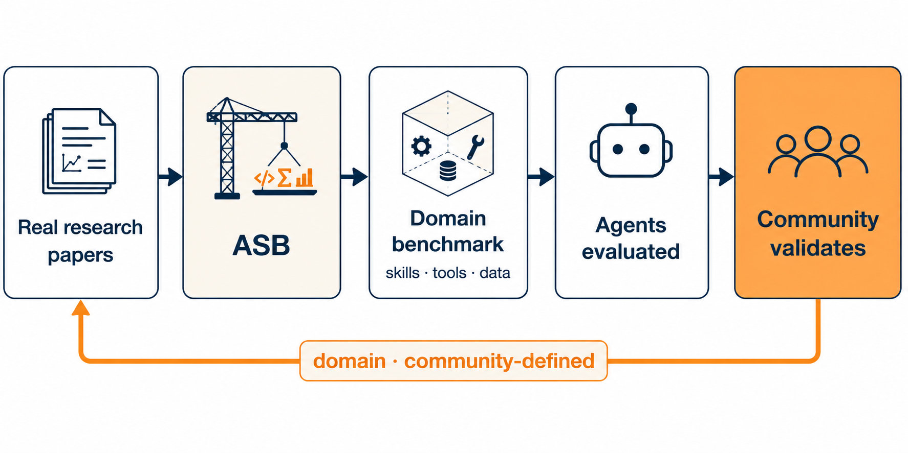
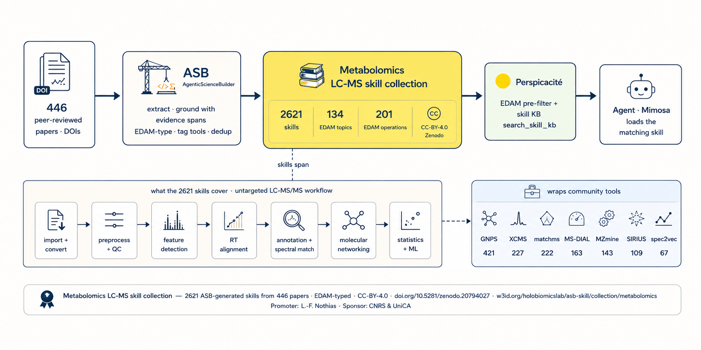

<p align="center">
  <picture>
    <source media="(prefers-color-scheme: dark)" srcset="assets/brand/asb-logo-dark.svg">
    <source media="(prefers-color-scheme: light)" srcset="assets/brand/asb-logo.svg">
    
  </picture>
</p>

<h1 align="center">ASB Skill Collections</h1>

<p align="center">Evidence-grounded skills and software-tool records for scientific AI agents,<br>distilled from published method papers and their code by the AgenticScienceBuilder pipeline.</p>

<p align="center">
  <a href="https://doi.org/10.5281/zenodo.24122117"></a> <a href="https://doi.org/10.5281/zenodo.24122117"></a>
  <a href="https://doi.org/10.5281/zenodo.24122117"></a> <a href="https://doi.org/10.5281/zenodo.24122117"></a>
  <a href="https://doi.org/10.5281/zenodo.24122117"></a> <a href="LICENSE"></a>
  <a href="LICENSING.md"></a> <a href="https://doi.org/10.5281/zenodo.20794026"></a>
</p>

A skill is a short procedure that an AI agent can read and follow. The
AgenticScienceBuilder (ASB) pipeline writes each one from a published method paper
(journal article or preprint) and, where one exists, its public code repository, anchors it to
verbatim evidence from those sources (for `repo-oa` papers, the repository's own
documentation; [CONTENT_POLICY.md](governance/CONTENT_POLICY.md)), annotates it with
EDAM terms, and passes it through a licence and PII gate before release. This
repository is the public registry of those collections. It holds the install and
search tooling, the governance of the community that curates them, and the
release registry. Released content lives in per-domain repositories. The project started at the
Dagstuhl Seminar **Computational Metabolomics**
([26181](https://www.dagstuhl.de/en/seminars/seminar-calendar/seminar-details/26181),
26 to 30 April 2026).

## Releases

The registry [`collections.yaml`](collections.yaml) records the released
collections of ten domains. Each release is deposited on Zenodo and pinned to its
domain repository `asb-skills-<domain>`, commit and tree digest. The domain
repositories are private; the Zenodo record of each release carries the full
collection. This repository holds the tooling and the registry.

| Domain | Release | Skills | Tools | Workflows | Papers | Version DOI |
|---|---|---:|---:|---:|---:|---|
| metabolomics | `metabolomics-v3.0.2` | 11,830 | 1,989 | 20 | 477 | [10.5281/zenodo.24122117](https://doi.org/10.5281/zenodo.24122117) |
| agentic-ai | `agentic-ai-v1.0.1` | 668 | 215 | 2 | 29 | [10.5281/zenodo.24122112](https://doi.org/10.5281/zenodo.24122112) |
| astronomy | `astronomy-v1.0.1` | 1,671 | 415 | 2 | 100 | [10.5281/zenodo.24122111](https://doi.org/10.5281/zenodo.24122111) |
| epigenomics | `epigenomics-v2.0.1` | 2,295 | 532 | 2 | 92 | [10.5281/zenodo.24122116](https://doi.org/10.5281/zenodo.24122116) |
| genomics | `genomics-v1.0.1` | 3,246 | 867 | 2 | 137 | [10.5281/zenodo.24122105](https://doi.org/10.5281/zenodo.24122105) |
| metabarcoding | `metabarcoding-v1.0.1` | 803 | 203 | 2 | 29 | [10.5281/zenodo.24122109](https://doi.org/10.5281/zenodo.24122109) |
| metagenomics | `metagenomics-v1.0.1` | 2,754 | 717 | 2 | 117 | [10.5281/zenodo.24122106](https://doi.org/10.5281/zenodo.24122106) |
| multi-omics | `multi-omics-v1.0.1` | 787 | 211 | 2 | 29 | [10.5281/zenodo.24122110](https://doi.org/10.5281/zenodo.24122110) |
| proteomics | `proteomics-v1.0.1` | 558 | 163 | 2 | 28 | [10.5281/zenodo.24122102](https://doi.org/10.5281/zenodo.24122102) |
| transcriptomics | `transcriptomics-v2.0.1` | 11,256 | 2,086 | 2 | 450 | [10.5281/zenodo.24122113](https://doi.org/10.5281/zenodo.24122113) |

The concept DOI of each domain is in [`collections.yaml`](collections.yaml). The
rest of this file uses metabolomics v3 as its worked example; `asbb fetch` and
`asbb install` take any registered collection, for example
`--collection genomics/v1`.

### Metabolomics v3

Release `metabolomics-v3.0.2`: **11,830 skills** across **1,989 tools**, distilled
from **477 published method papers (journal articles and preprints)**, plus **20
composite workflow super-skills** that chain the atomic skills into end-to-end
pipelines. The release is deposited as
[10.5281/zenodo.24122117](https://doi.org/10.5281/zenodo.24122117). Coverage is mostly
LC-MS/MS, with LC-MS, GC-MS, mass-spectrometry imaging, ion mobility and
lipidomics, some NMR, and multi-omics, statistics and pathway tools.

The collection is released from the private domain repository
`asb-skills-metabolomics`. The marketplace of this repository serves the v3
collection and the v2-derived technique packs from that domain repository.

| Layer | Contents | State |
|---|---|---|
| ASB-Skills | evidence-grounded procedural skills | released |
| ASB-Workflows | composite end-to-end pipeline super-skills | released |
| ASB-Tools | deduplicated software-tool records with EDAM terms and DOIs | released |
| ASB-Benchmark | per-paper tasks and claim-retrieval test sets | later |
| ASB-Capsules | raw per-paper pipeline outputs, for full traceability | later |

<p align="center">
  
</p>

## Install

**Claude Code** (plugin marketplace):

```bash
/plugin marketplace add HolobiomicsLab/asb-skill-collections
/plugin install metabolomics@asb-skill-collections
# Or one of the eight technique packs, for example:
/plugin install metabolomics-lc-ms@asb-skill-collections
```

The other released domains install the same way under their domain name, for
example `/plugin install genomics@asb-skill-collections`. Each marketplace entry
points at its private domain repository, so installation needs read access to
that repository. The nine domains released on 2026-11-09 were installed this
way on 2026-11-10, with Claude Code and with Codex CLI; the `metabolomics`
entry was last installed before its source moved to the domain repository
([docs/STATUS.md](docs/STATUS.md)).

**Codex CLI** reads the same marketplace file:

```bash
codex plugin marketplace add HolobiomicsLab/asb-skill-collections
codex plugin add <domain>@asb-skill-collections
```

The access requirement is the same. Without access to the private domain
repositories, neither route works: download the Zenodo record of the release
(version DOIs in the [Releases](#releases) table) and read it as described in
[AGENTS.md](AGENTS.md).

**Chosen leaves without a checkout** (`asbb fetch`, Python 3.12 or later):

```bash
asbb fetch <slugs> --collection metabolomics/v3 --dest <directory>
```

`fetch` reads [`collections.yaml`](collections.yaml) and downloads the selected
leaves from the domain repository at the pinned commit. Set `GITHUB_TOKEN` while
that repository is private.

**A derived selection from a domain checkout** (`asbb install`):

```bash
asbb install --repo <domain checkout> --skills <slug-a>,<slug-b> --collection metabolomics/v3 --runtime agents
```

The human guide is `<domain checkout>/collections/metabolomics/v3/USAGE.md` in
plain text. The complete release is also available from the
[Zenodo archive](https://doi.org/10.5281/zenodo.24122117). Install routes,
measured v2 examples and refusals are in
[docs/partial-install.md](docs/partial-install.md); the agent procedure is in
[AGENTS.md](AGENTS.md).

### Choose what to install

Install the whole collection, a technique pack, a selection of skills
(`asbb install --skills`, `--skills-file` or `--query`), or fetch chosen skills
without a checkout (`asbb fetch`). Commands, outputs and refusals:
[docs/partial-install.md](docs/partial-install.md).

The full `metabolomics` plugin serves v3: 11,830 skills over 1,989 tools. The
eight technique packs are the v2-derived packs shipped by the domain repository.
Their measured v2 sizes remain useful for choosing a pack; no v3 full-install
size is claimed here.

| Install | Technique tag | v2 leaves | Measured v2 size on 2026-10-31 |
|---|---|---:|---:|
| `metabolomics-lc-ms` | `LC-MS` | 2,617 | 29 MiB |
| `metabolomics-ms-generic` | `mass-spectrometry` | 804 | 8.5 MiB |
| `metabolomics-ion-mobility` | `ion-mobility-MS` | 385 | 4.3 MiB |
| `metabolomics-gc-ms` | `GC-MS` | 367 | 4.0 MiB |
| `metabolomics-ms-imaging` | `MS-imaging` | 291 | 3.2 MiB |
| `metabolomics-nmr` | `NMR` | 276 | 2.9 MiB |
| `metabolomics-ce-ms` | `CE-MS` | 113 | 1.4 MiB |
| `metabolomics-direct-infusion` | `direct-infusion-MS` | 97 | 1.1 MiB |
| a selection, `asbb install --repo <domain checkout> --skills a,b,c --collection metabolomics/v2 --runtime agents` | chosen slugs | 10 in the example | 188 KiB |
| a fetch, `asbb fetch a,b --collection metabolomics/v2 --dest DIR` | chosen slugs | 10 in the example | 112 KiB |

The eight packs install by name with `/plugin install <name>@asb-skill-collections`.
Their sizes are `du -sk` of the v2 units measured before the domain split. The
selection and fetch rows are the 10-skill example of
[docs/partial-install.md](docs/partial-install.md#sizes), and a fetch also
downloaded the 5.2 MiB (5,430,046 bytes) v2 `skills_index.json` at measurement
time.

Packs overlap: a skill tagged with several techniques is in several packs, so
install the full collection or a few packs, not both. The 1,520 technique-agnostic
skills (statistics, pathway and generic data-handling procedures) carry no
technique tag and are in no pack; they come with the full collection, a selection
or a fetch.

## Use: search, apply, ground

**Search** a domain checkout offline, with no API key and the tooling installed:

```bash
uv venv -p 3.12 --allow-existing && source .venv/bin/activate
uv pip install -e .            # in a python3.12 -m venv environment: python -m pip install -e .
asbb search "untargeted LC-MS/MS annotation" --collection metabolomics --target workflows
asbb get untargeted-lcmsms-annotation --collection metabolomics/v2 --target workflows
asbb search --list-collections
```

Without installing, `python3 -m asb_skill_collections.asbb_cli` runs the same
commands.

An installed collection searches itself, with no tooling and no network:

```bash
python3 "<collection root>/bin/search_skills.py" --query "<task>" -k 10
python3 "<collection root>/bin/search_skills.py" --query "<goal>" --target workflows -k 3
python3 "<collection root>/bin/search_skills.py" --query "<tool or task>" --target tools -k 5
```

`<collection root>` is the directory that holds `skills_index.json`; in an
installed plugin it is two directories above the router's `SKILL.md`. Written as
an absolute path, the command runs from any directory. The routers of the
releases of 2026-11-09 print `python bin/search_skills.py`, relative to the
collection root: it fails from any other directory and on a system with only
`python3`, so run the form above instead. The CLI, the router, the MCP server and the collection-level search
scripts share one versioned selector; each hit reports its score, matched fields
and qualified slug. [How offline skill selection works](docs/selection.md)
documents the rule, its tie handling and its 22-query measurement.

**Apply.** Read the skill's `SKILL.md` (the `read:` path of the hit) and follow
the procedure. Tool requirements are in its frontmatter and in
`<domain checkout>/collections/metabolomics/v3/USAGE.md`, section 0.

**Ground.** To check an exact parameter, threshold or claim (the difference
between "the skill says about 5 ppm" and "the paper specifies 5 ppm"), ground the
skill against its source paper. Grounding is optional. Every released collection
ships the grounding map `kb_bundle.json`; the binder is
[`scripts/perspicacite_kb_bind.py`](scripts/perspicacite_kb_bind.py) in this
repository, and a selection built with `asbb install` carries a copy. It uses
[Perspicacité](https://github.com/HolobiomicsLab/Perspicacite-AI),
Holobiomics Lab's local-first literature RAG engine, with two backends:

- **`kb`**: RAG over the paper's full text and supplementary information. The
  per-paper KB (`asb-paper-<doi>`) is created on first use through the Perspicacité
  HTTP API; no MCP server is required. Needs Perspicacité at `PERSPICACITE_BASE`
  (default `http://127.0.0.1:8000`).
- **`local`**: no server. Clones the skill's source repository and fetches the
  open-access paper where possible. Needs `git` and network.

Run `python3 scripts/perspicacite_kb_bind.py` (`prepare`, `query`, `local`,
`resolve`) with `--collection "<collection root>" --skill <slug>`; in a selection
built with `asbb install`, its `bin/` copy and the `/ground` command do the same.
Full guide: `<domain checkout>/collections/metabolomics/v3/USAGE.md`, section 5.

## What is in the collection

<p align="center">
  
  <br><sub>The LC-MS view of the collection (the <code>metabolomics-lc-ms</code> pack). The full release covers all techniques.</sub>
</p>

| File | Contents |
|---|---|
| `leaves/<slug>/SKILL.md` | one evidence-grounded skill each (frontmatter: EDAM IRIs, `provenance.source_papers` DOIs and titles, `tools` with their roles, `metadata.license_tier`; verbatim evidence lines in the body). Shipped as data and read on demand, so installing does not load the corpus into the session's context. |
| `skills/_router/SKILL.md` | the one advertised entry, the router `<domain>-router` |
| `workflows/<slug>/SKILL.md` | composite workflows, their index `workflows/workflows_index.json` and their router `workflows/_workflow_router/SKILL.md` (not advertised) |
| `tools/<slug>.yaml` | deduplicated software-tool records with EDAM terms and source DOIs |
| `skills_index.json`, `tools_index.json` | machine search indexes (EDAM IRI, tool name, keyword) |
| `bin/search_skills.py` | the offline search over skills, workflows and tools (standard library only) |
| `kb_bundle.json` | skill to source-paper KB slugs and `repo_urls` (the grounding map) |
| `collection.yaml`, `corpus.yaml`, `mapping.json` | collection record; per-paper access basis (`repo-oa`); each leaf mapped to its source build records and DOIs |
| `CITATION.cff` | citation |

These files are relative to `<domain checkout>/collections/metabolomics/v3/`;
the other released collections have the same layout. No released collection
ships the grounding binder or a `commands/` directory. The release-gate report
and the other receipts are in the domain repository under `receipts/<cut-id>/`.

Local build-capsule archives and record metadata are packed and screened by
[`scripts/pack_capsules.py`](docs/capsules-record.md), without deposit or upload.

## How it was generated

Skills come from method papers anchored to the computational metabolomics review
series ([SOURCES.md](governance/SOURCES.md): sources and inclusion criteria;
[CONTENT_POLICY.md](governance/CONTENT_POLICY.md): legal and open-access policy).
The receipts under `<domain checkout>/receipts/<cut-id>/` and the Zenodo record
carry the release provenance. The method records the exact build command
and model routing: Claude Opus 4.8 for outline and card revision, Claude Haiku
4.5 for the other stages, OpenAI `text-embedding-3-large` and `-small` for
embeddings, each build recorded in `build_manifest.json`.

## Repository family

| Repository | Role | Access |
|---|---|---|
| asb-skill-collections (this one) | `asb_skill_collections` tooling, `scripts/`, tests, governance, registry, catalogue and docs-site | public |
| AgenticScienceBuilder | the pipeline and schema that generate the collections | private, to follow |
| asb-skills-metabolomics | `<domain checkout>/collections/metabolomics/<version>/`, `<domain checkout>/packs/metabolomics/<technique>/`, `<domain checkout>/staged-collections/metabolomics/` and receipts; v3 deposited on Zenodo | private |
| asb-skills-&lt;domain&gt; | one repository per other domain, with `<domain checkout>/collections/<domain>/<version>/`, `<domain checkout>/packs/<domain>/<technique>/`, `<domain checkout>/staged-collections/<domain>/` and receipts; each release deposited on Zenodo | private |
| indicium | standard for a typed scientific claim bound to the evidence that grounds it | private, to follow |
| indicium-adapters, indicium-adapters-&lt;domain&gt; | per-domain adapters that enrich indicium claims with ontology terms | private, to follow |
| [Perspicacite-AI](https://github.com/HolobiomicsLab/Perspicacite-AI) | literature RAG engine used for grounding | public |
| [Mimosa-AI](https://github.com/HolobiomicsLab/Mimosa-AI) | multi-agent framework for autonomous scientific research | public |

[`collections.yaml`](collections.yaml) pins each published domain release to its
repository, commit, collection path and tree digest. Domain and adapter
repositories exist for metabolomics and nine further domains
(agentic AI, astronomy, epigenomics, genomics, metabarcoding, metagenomics, multi-omics,
proteomics, transcriptomics). Each domain has a release recorded in the
registry and deposited on Zenodo, and is released from its own domain
repository; the domain repositories are private. The legacy epigenomics,
transcriptomics and metabolomics v1 trees are recorded in the registry and are
not part of any release.

For a new domain, follow [Domain onboarding and release](docs/domain-onboarding.md).

## Attribution and citation

Cite the collection and the original paper behind each skill you use
(the DOIs in `provenance.source_papers` in its `SKILL.md`).

- **Other domains.** The concept DOI of each domain and the version DOI of each
  release are recorded in [`collections.yaml`](collections.yaml); the version
  DOIs are also listed under [Releases](#releases). The entries below are those
  of metabolomics.
- **Concept DOI**, metabolomics, for all its versions: [10.5281/zenodo.20794026](https://doi.org/10.5281/zenodo.20794026).
- **Version DOI**, v3, release `metabolomics-v3.0.2` (10 November 2026): [10.5281/zenodo.24122117](https://doi.org/10.5281/zenodo.24122117);
  the release is recorded in [`collections.yaml`](collections.yaml). The
  earlier v3 deposits of 9 November 2026, `metabolomics-v3.0.1`
  ([10.5281/zenodo.24093587](https://doi.org/10.5281/zenodo.24093587)) and `metabolomics-v3.0.0`
  ([10.5281/zenodo.24054446](https://doi.org/10.5281/zenodo.24054446)), are
  listed as superseded in the v3 row of the registry.
- **Previous version DOI**, v2 (22 June 2026):
  [10.5281/zenodo.20794027](https://doi.org/10.5281/zenodo.20794027). The
  registry records the domain commit and tree digest for each version.
- **Version citation files.** The v2 and v3 `CITATION.cff` files are
  `<domain checkout>/collections/metabolomics/v2/CITATION.cff` and
  `<domain checkout>/collections/metabolomics/v3/CITATION.cff`.
- **Authors.** The v2 deposit:
  AgenticScienceBuilder Community, Louis-Félix Nothias, HolobiomicsLab.cnrs.fr, MetaboLinkAI.net.
  The concept record in this repository ([root CITATION.cff](CITATION.cff)): Louis-Félix Nothias and
  the AgenticScienceBuilder AI framework, joined by curators ([call for curators](docs/CURATION_CALL.md)).
- **Roles** (`roles` in `collection.yaml`, `attribution:` in each workflow `SKILL.md`): `generator` (the ASB
  pipeline), `curators` (none yet), `promoter` (Louis-Félix Nothias), `sponsor`
  (CNRS and Université Côte d'Azur, who paid the API cost).

## Governance and licensing

Every skill carries a `license_tier` (in `skills_index.json` and in its `SKILL.md`
frontmatter, `metadata.license_tier`) that answers *what may I do with the underlying tool?*

| Tier | Meaning |
|---|---|
| `open` | commercial use allowed (MIT, Apache-2.0, GPL, CC-BY, ...) |
| `noncommercial` | academic or noncommercial use only; **confirm permitted use before applying** the skill |
| `restricted` | licence established and it constrains reuse; **check it before commercial use or redistribution** |
| `unknown` | no licence for the tool was established; describing and using are unaffected; treat it as all rights reserved and **never redistribute** the tool's code |

The search tools do not filter or rank by tier; each skill hit prints its tier.
The router asks the agent to get confirmation of a non-commercial purpose before
applying a `noncommercial` skill
([LICENSE_TIERS.md](governance/LICENSE_TIERS.md)). Code is
under [Apache-2.0](LICENSE), collection content under CC-BY-4.0; verbatim quotations
(`evidence_spans`) are minimal and attributed, and a rights holder may request removal
([LICENSING.md](LICENSING.md)). Other policies are in [governance/](governance), starting
with [MAINTAINERS.md](governance/MAINTAINERS.md) and [COI_POLICY.md](governance/COI_POLICY.md).

## Contributing

- **A skill was wrong, stale or missing.** From a checkout,
  `scripts/make_improvement_report.py` prints an anonymised issue body, and with
  `--print-url` a pre-filled issue URL.
- **Propose or annotate a paper, a collection or a workflow:**
  [CONTRIBUTING.md](.github/CONTRIBUTING.md#propose-or-annotate-a-paper).
- **Add papers to a collection.** See the contributor proposal rail and the
  maintainer build, view, cut and candidate rail in
  [Adding papers to a collection](docs/adding-papers.md). Released collections
  are listed in [`collections.yaml`](collections.yaml); each lives in a private
  domain repository `asb-skills-<domain>`. Domain content and candidates
  belong in the corresponding `asb-skills-<domain>` checkout; this repository
  holds tooling, governance and the registry.
- **Credit.** Merged contributions count on the contributor leaderboard and can lead
  to co-authorship of the next release DOI ([CONTRIBUTION_LOOP.md](governance/CONTRIBUTION_LOOP.md)).
- **Before packaging,** run `python -m scripts.unit_closure` from the repository root:
  it compares each shipped unit's indexes with its leaves and checks declared
  `metadata.helper` files.

## Status

- Step 2 of the per-domain split is complete: this master is the registry and tooling repository; released content is in the domain repositories.
- The managed-install and Claude Code measurements predate the new marketplace sources; see [docs/STATUS.md](docs/STATUS.md) for their scope and dates.
- Pending or experimental: the other seven packs, the web UI, runtime adapters other than `agents`, the MCP server. Not yet published: PyPI, the HuggingFace mirror, the benchmark and the capsules. The [documentation site](https://holobiomicslab.github.io/asb-skill-collections/) is live.
- The `w3id.org/holobiomicslab/` and `w3id.org/asb` identifiers resolve. Dates, measurements and detail per surface: [docs/STATUS.md](docs/STATUS.md).

## Acknowledgements

We thank the participants and organisers of Dagstuhl Seminar 26181, Computational
Metabolomics, where this collaboration began. API generation costs for this
collection were sponsored by CNRS and Université Côte d'Azur. Maintained by
[Holobiomics Lab](https://github.com/HolobiomicsLab) (CNRS, Université Côte d'Azur).
